# svn-git 文件版本管理

> **SVN / Git 双引擎图形化版本管理工具**：桌面窗口或浏览器界面、行级冲突防护、局域网只读共享，一套工具统一管理两种版本库。


在 Linux / Windows 桌面上同时使用 SVN 和 Git 的项目与团队，不用再装两套 GUI 客户端。本工具提供状态检测、历史记录、并排差异对比、分支 / 标签 / 工作树 / Stash、文件夹浏览、代码统计、局域网共享、GitHub 集成、发版与在线更新，以及行业内少见的**行级冲突检测 + 提交拦截 + 三方冲突解决**完整防护闭环。纯本地服务，凭据不落盘明文，操作命令全程透明可预览。

- 详细使用教程：[Git 使用说明](docs/usage-git.md) · [SVN 使用说明](docs/usage-svn.md)
- 架构设计：[docs/architecture.md](docs/architecture.md) · 项目优势：[docs/advantages.md](docs/advantages.md) · 发版指南：[docs/发版脚本生成指南.md](docs/发版脚本生成指南.md)

---

## ✨ 特色一览

| 特色 | 说明 |
|---|---|
| **双引擎统一** | 自动识别仓库类型，SVN / Git 同一套界面与操作；分支 / 标签 / 提交 / 更新 / 还原体验一致 |
| **行级冲突防护闭环** | 提交前精确到「哪个文件第几行冲突」强制拦截 → 服务器更新交集提示 → 2 分钟主动监控 → 三方冲突解决器，四层防护一气呵成 |
| **局域网只读共享** | 一个开关把当前项目分享给同事：IP / CIDR 白名单、人数上限、远程只读，主机实时收到加入 / 离开通知 |
| **完整文件管理** | 网格 / 列表 / 树三种视图、多选批量操作、拖拽上传、剪贴板、行数过滤、Markdown 预览、模块说明注入 |
| **代码统计** | 目录勾选后流式统计行数与文件数，目录小计逐级汇总，一键导出 Markdown 统计报告 |
| **发布中心** | 发布历史与产物下载、发版脚本一键执行、本地打包、Docker 镜像、旧版本清理，集成 GitHub Actions 状态 |
| **在线更新** | AppImage / Portable / WSL 包内检查新版本、下载校验、自动换版重启，失败自动回滚 |
| **命令预览** | 悬浮任何操作按钮 / 菜单项，直接显示「将执行的真实命令」，教学与透明两不误 |
| **凭据安全** | SVN 密码走 `--password-from-stdin`（ps 不可见）、配置文件 600 权限；Git 认证用 `GIT_ASKPASS` 重试 |
| **零部署轻量** | 单个 AppImage 内置 Electron，目标机无需 Node / 浏览器；后端零框架，仅监听本机 |

---

## 🚀 快速开始

### 方式一：AppImage（Linux，推荐）

下载 `svn-git-1.7.2.AppImage` 后：

```bash
chmod +x ./svn-git-1.7.2.AppImage   # 首次需要执行权限
./svn-git-1.7.2.AppImage            # 直接运行，弹出应用窗口
SVNGIT_DIR=/path/to/repo ./svn-git-1.7.2.AppImage   # 指定启动目录
```

默认启动后弹出**应用窗口**（内置 Electron 渲染引擎，不依赖系统浏览器）；关闭窗口即退出。

**终端里直接运行**（不带参数）会先让选择运行方式：应用窗口 / 浏览器·前台 / 浏览器·后台；带 `--browser` 或 `-d` 参数则跳过菜单：

```bash
./svn-git-1.7.2.AppImage --browser      # 改用系统浏览器，服务后台运行
./svn-git-1.7.2.AppImage --browser -d   # 启动后命令立即返回，服务常驻
```

停止方式统一为页面右上角「退出应用」。

> 环境要求：
> - 系统需安装 `svn` 和 `git` 命令（启动时自动检测，缺失时引导安装）
> - AppImage 依赖 FUSE；无法挂载时用 `--appimage-extract-and-run` 运行

### 方式二：源码运行

一键脚本（装依赖 → 构建 → 启动，浏览器自动打开 http://127.0.0.1:23456）：

```bash
./run.sh               # Linux / macOS
run.bat                # Windows
```

手动分步：

```bash
npm install
npm run dev            # 开发模式（热更新，浏览器访问 http://127.0.0.1:23456）
npm run dist:linux     # 打包 AppImage
npm run dist:win       # 打包 Windows 安装包
```

### 方式三：Windows

双击 `deploy/build.bat` 出**免安装单文件 exe**（portable，对标 Linux 的 AppImage），`npm run dist:win` 出**安装包**，产物都在 `deploy/release/`。安装包另由 GitHub Actions 在 tag 发布时自动构建。

Windows 前置：SVN 命令行两条路——装纯命令行的 [SlikSVN](https://sliksvn.com/)（`winget install --id=Slik.Subversion -e`，推荐），或装 [TortoiseSVN](https://tortoisesvn.net/) 时**勾选 command line client tools**；再装 [Git for Windows](https://git-scm.com/)。工具内「环境检测 → 下载安装」可一键装 SlikSVN。

```bat
svn-git-1.7.2-portable.exe --browser      :: 用系统浏览器
svn-git-1.7.2-portable.exe --browser -d   :: 后台常驻
set SVNGIT_DIR=D:\repo                     :: 指定启动目录
```

### 方式四：WSL / 纯 Node 包

`deploy/build-wsl.sh` 生成可直接解压运行的 tar.gz（可内置 Node），包内自带 `run-wsl.sh`，支持在线更新与目录换版。详见 `deploy/README.md`。

---

## 📸 功能预览

| 打开项目（最近项目 + 目录浏览） | 文件浏览（网格 / 状态徽标） |
|---|---|
| 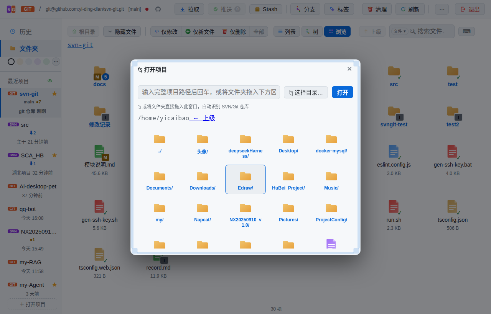 | 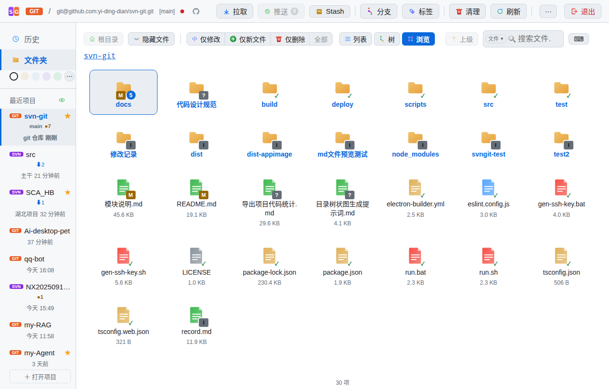 |

| 树视图（模块说明注入） | 历史记录（提交总数 / 过滤 / 未推送标记） |
|---|---|
| 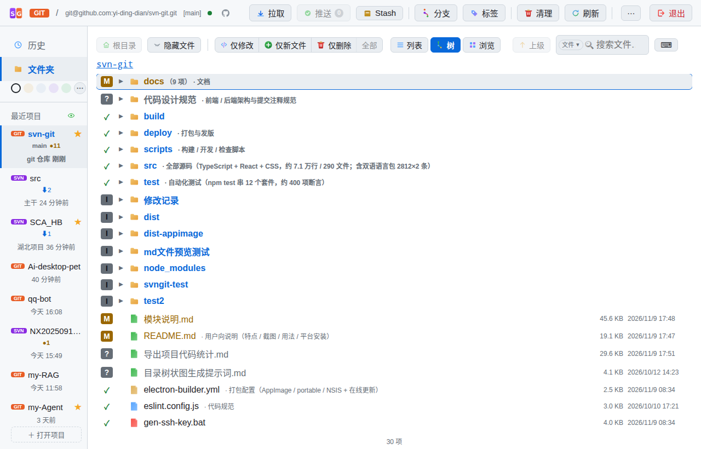 | 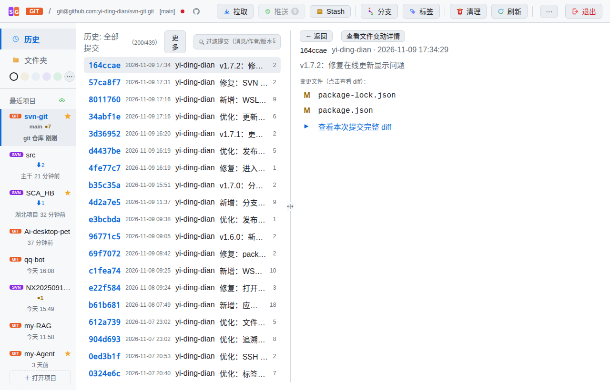 |

| 并排差异对比 | 分支管理（本地 / 远程 / 工作树） |
|---|---|
| 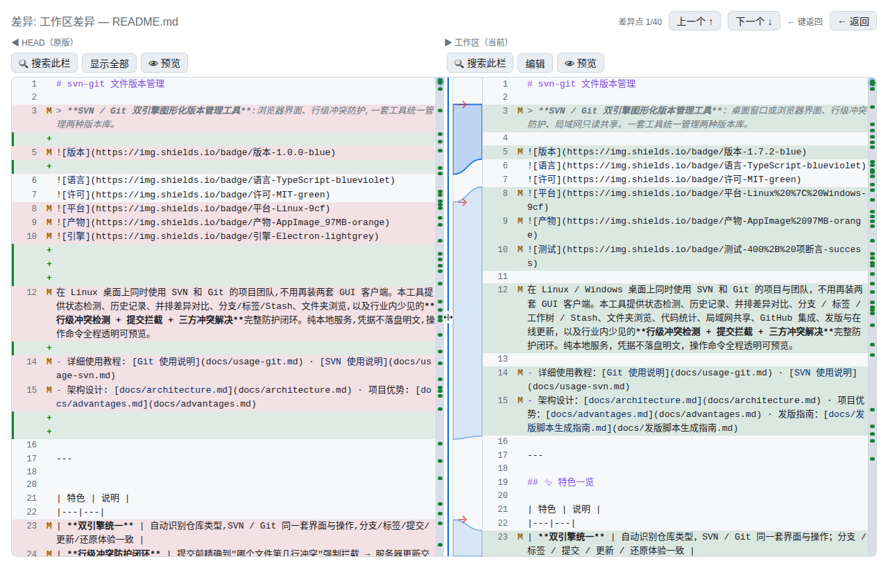 | 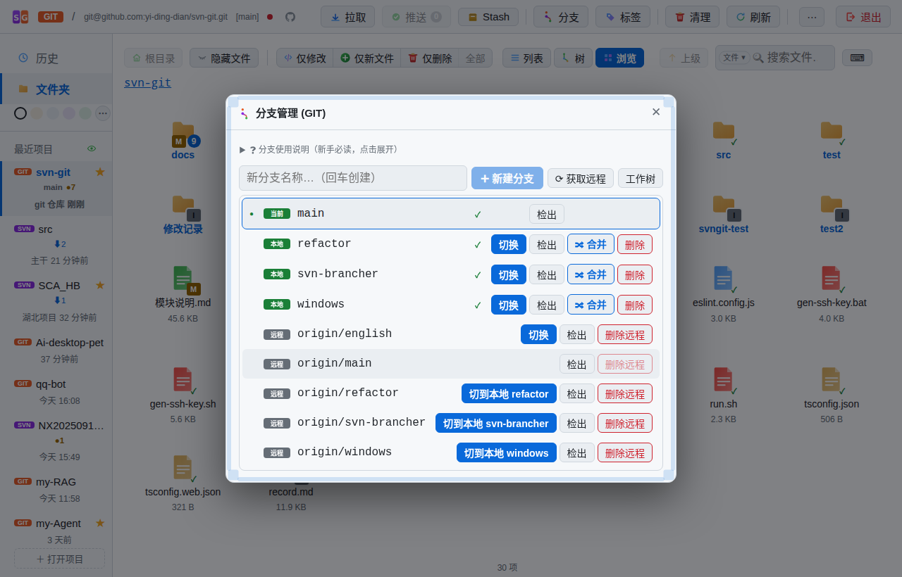 |

| 标签管理 | 勾选式提交 |
|---|---|
| 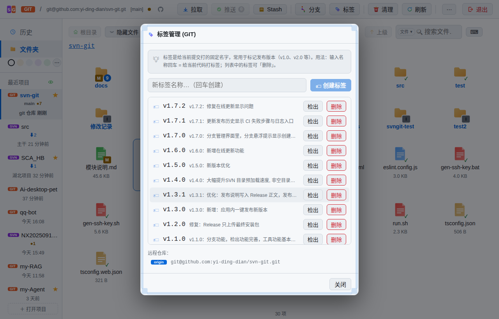 | 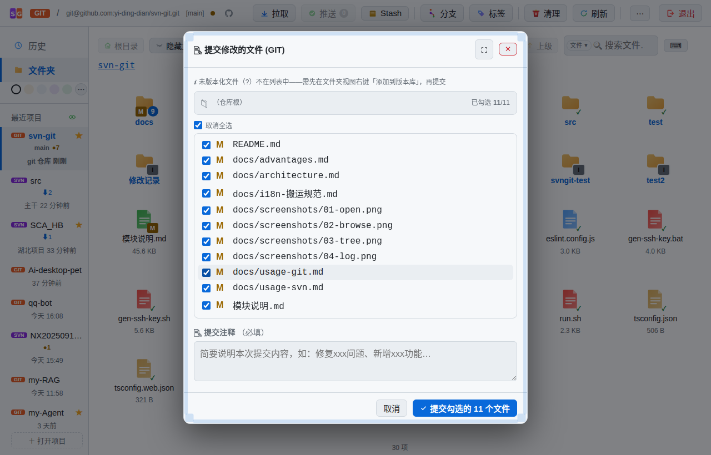 |

| 项目代码统计 | 发布中心（历史 / 新版本 / 本地打包） |
|---|---|
| 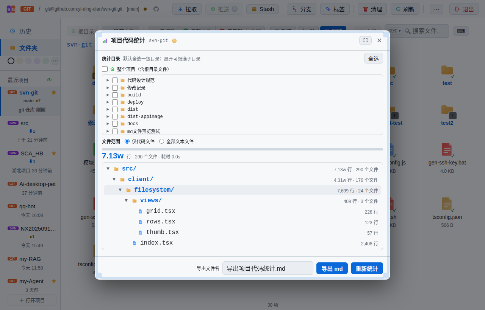 | 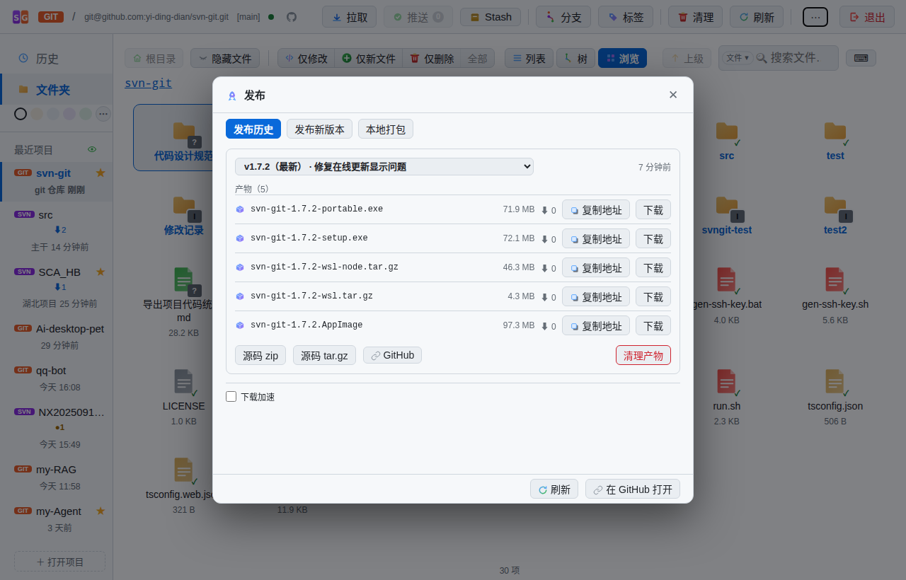 |

| 16 套主题 + 自定义配色 | 局域网共享（只读 / 白名单 / 人数上限） |
|---|---|
| 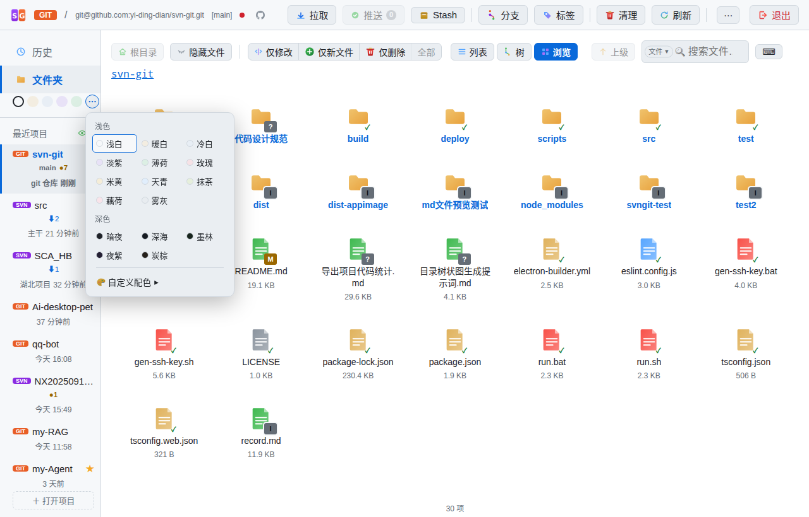 | 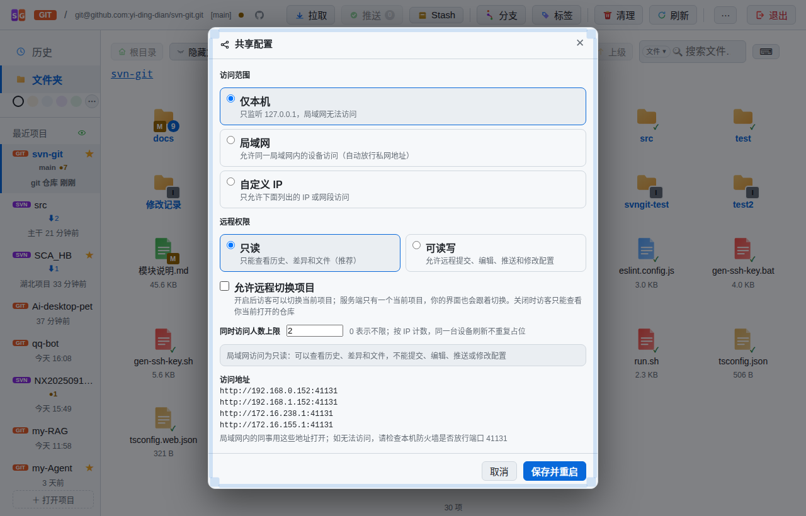 |

**变动文件定位（动态演示）**：状态过滤 → 双击结果 → 自动跳转目录并点亮面包屑。

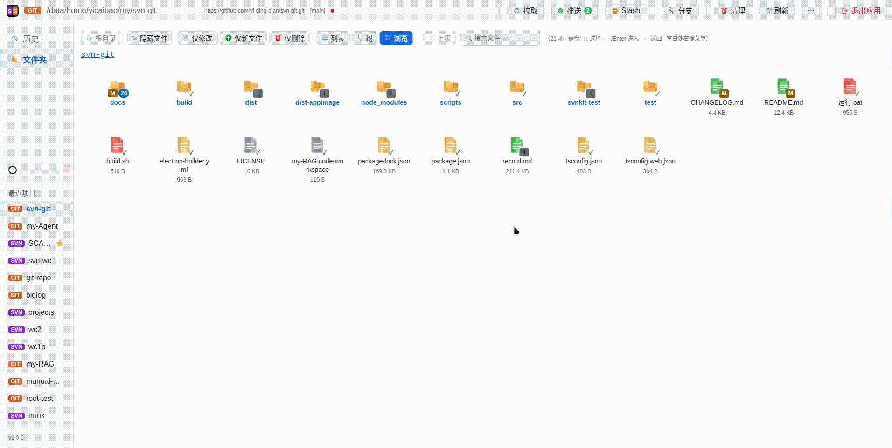

> 截图基于当前真实项目；SVN 仓库界面与操作一致（工具栏少 Stash / 推送，多更新 / 清理 / 登录），见 [SVN 使用说明](docs/usage-svn.md)。

---

## 🏗 技术栈与项目结构

### 技术栈

| 层 | 技术 |
|---|---|
| 前端 | React 18 + TypeScript（esbuild 单文件打包） |
| 服务 | Node 内置 http（REST API + SSE + NDJSON 流），仅监听 127.0.0.1，固定端口 23456 |
| 桌面外壳 | Electron 33（可选；纯 node 也能跑，供浏览器或 WSL 访问） |
| VCS | 包装官方 `svn` / `git` 命令行（`--xml` / `--porcelain` / `--format` 机器格式） |
| 打包 | electron-builder（AppImage / portable / NSIS）+ WSL tar.gz |
| 规模 | src 约 7.1 万行、290 个文件；界面文案 2812 条 × 中英双语 |

### 目录结构

```
src/
├── main/              # Electron 入口（窗口 / --browser / -d）+ 在线更新
├── preload/           # Electron preload（拖拽文件路径 / 标题栏）
├── config.ts          # 配置读写（~/.config/svngit/config.json，600 权限）
├── server/
│   ├── index.ts       # HTTP 骨架：CSRF / 共享门禁 / 路由分发 / 静态文件
│   ├── access-control.ts # 局域网共享会话与只读控制
│   └── routes/        # 34 个 API 域文件（ops/、browse/ 再分子模块）
├── vcs/               # VCS 抽象层
│   ├── types.ts       #   统一 Vcs 接口（22 个公共方法 + 22 个可选能力）
│   ├── index.ts       #   createVcs 工厂
│   ├── svn.ts         #   SVN 实现（--xml、status -u、分支/合并/锁）
│   ├── git.ts         #   Git 实现（porcelain、merge-tree、工作树、Stash）
│   ├── exec.ts        #   子进程封装（stdin 传密码 / 超时 / 取消 / 输出上限）
│   ├── diff-lines.ts  #   行级冲突算法（纯函数）
│   ├── hunks.ts       #   hunk 解析与 patch 构造（纯函数）
│   ├── ignore.ts      #   .gitignore / svn:ignore 权威判定
│   └── detect.ts      #   仓库类型识别
├── platform/          # 平台抽象（win32 / linux 双实现）
├── practice/          # 练习仓库生成（Git / SVN 演示与冲突场景）
├── shared/            # 前后端共享（类型 / 文本编码 / 冲突解析 / 中英文案）
└── client/            # React 前端（按业务域分目录，13 个域）
    ├── shell/         #   主框架：视图调度 / 提交预检 / 冲突拦截 / 顶栏 / 侧边栏
    ├── filesystem/    #   文件浏览：三视图 / 多选 / 拖拽 / 搜索 / 行数过滤 / 预览
    ├── history/       #   历史记录与并排差异
    ├── conflicts/     #   三方冲突解决器 / 远程冲突
    ├── ops/           #   提交 / 推送 / 分支 / 标签 / Stash / 发布
    ├── repo/          #   打开 / 新建 / 获取 / 检出 / 工作树 / GitHub / 认证
    ├── share/         #   局域网共享前端
    ├── stats/         #   代码统计
    ├── appearance/    #   主题 / 字体 / 缩放
    ├── animations/    #   操作动效
    ├── terminal/      #   内置终端
    └── ui/ shared/    #   通用组件与前端公共层
scripts/               # 构建 / 开发 / 检查 / 截图脚本
deploy/                # 打包与发版（AppImage / portable / WSL / release.mjs）
test/                  # 自动化测试（12 个套件 + Playwright 冒烟）
```

### 架构

```
Web 前端（React + esbuild 单文件）
    ↕ REST API + SSE + NDJSON
HTTP 服务层（Node 内置 http，仅本机；局域网共享走访问门禁）
    ↕ 统一 Vcs 接口
VCS 抽象层（SvnVcs / GitVcs，包装官方命令行）
    ↕
svn / git 命令行（系统安装）
```

- 只解析官方 `--xml` / `--porcelain` 机器格式，不解析内部格式
- 密码走 `--password-from-stdin`（ps 不可见），配置文件 600 权限
- 所有 API 做 Origin / Host 校验；路径接口两侧 realpath 校验防穿越

---

## 📦 功能总览

### 状态与浏览

- **三种文件视图**：列表 / 树 / 文件浏览器（图标网格、状态角标、修改数量标识），切换保留位置与选中
- 文件 / 文件夹状态徽标：M 黄 / A 绿 / D 红 / ? 灰 / ! 紫 / C 红底；目录聚合角标显示子树修改数
- **状态过滤**：工具栏「仅修改 / 仅新文件 / 仅删除」可多选组合，过滤结果以树视图展示，双击文件直接跳转定位（面包屑点亮动画）
- **行数过滤**：搜索框选「行数」，输入 `1000`（≥1000 行）、`>1000` 或 `<100`，按行数筛选当前目录（含子目录），用于排查大代码文件
- 文件名 / 内容搜索、键盘导航（↑↓ / → 进入 / ← 返回）、右键上下文菜单、面包屑导航
- **多选批量操作**：矩形框选 / Ctrl 点选 / Shift 范围选；右键菜单按选中集合的**操作能力分组**（添加 / 提交 / 还原 / 从版本库移除 / 移到回收站 / 复制路径，各自带计数，混选自动拆分）
- **文件 / 文件夹重命名**：版本化文件走 `svn move` / `git mv`，未版本化文件直接磁盘改名
- **文件剪贴板**：复制 / 剪切 → 任意目录「粘贴到这里」；剪切中的条目半透明标记
- **拖拽上传**：文件 / 文件夹拖进窗口上传到当前目录，同名冲突可选覆盖 / 跳过 / 逐个改名；可删条目拖到窗口边缘丢弃到回收站
- **Markdown 预览**：md 渲染 + 文档目录浮层，图片与代码高亮，8 档阅读主题
- **内容复制**：预览 / 差异正文右键「复制所选 / 复制全部」，`Ctrl+A` 全选正文
- **模块索引**：解析仓库内 md 的「目录树 ← 说明」或表格，勾选后把说明注入对应目录的文件列表
- 常用文件夹预加载（SVN 勾选目录后台缓存，点击秒开）

### 历史与差异

- 提交历史：版本 / 作者 / 时间 / 信息，顶部显示提交总数，支持按消息 / 作者 / 版本号模糊过滤
- Git 未推送提交带绿点标记，可右键**修改注释**（amend / reword）或撤销（reset --soft）
- **并排双栏对比**：左原版右当前，修改行标记，滚动条绿红点全局预览，点击修改处双向跳转；中间分隔栏可拖动调宽（15%–85%）
- 左右栏**独立搜索框**、块导航、同步滚动、按块还原、右栏就地编辑
- 代码语法高亮（11 种语言）、Blame 逐行追溯（版本 + 作者）
- 历史提交文件变动详情：左文件列表 + 右差异，可切换提交

### 版本管理操作

- **SVN + Git 统一**：分支（创建 / 切换 / 合并 / 删除）、标签（创建 / 删除）；切换 / 合并前自动预检工作区改动与冲突文件
- **Git 专属**：Stash、推送（未推送计数角标 + 确认弹窗 + 进度窗可取消）、清理未跟踪文件、修改提交注释、撤销提交、工作树管理、hunk 级部分提交
- **Git 远程分支**：分支弹窗中远程行可删除远程 / 推送到远程（首次自动建立上游跟踪）
- **SVN 专属**：锁定 / 解锁、svn:ignore、svn cleanup、切回主干、项目迁移、更新结果详情弹窗
- **检出与工作树**：SVN 选择性检出、Git 分支 / 标签检出（完整克隆 / 浅克隆 / worktree）
- **获取即后台任务**：点确认立即关闭，进度 / 取消在顶栏沙漏；完成自动打开项目，失败进铃铛，认证失败自动弹凭据框并重试
- **勾选式提交**：提交弹窗内文件可勾选（默认全选），提交前二次确认；未版本化文件需先「添加到版本库」
- **命令预览**：悬浮菜单项 / 按钮显示将执行的真实命令（git / svn 双引擎模板）

### 🛡 并发修改防护（特色）

1. **行级冲突检测**：提交时精确提示「哪个文件第几行冲突」，强制拦截 + 处理指引
2. **服务器更新交集提示**：服务器有新提交且待提交文件与更新文件有交集时，弹窗列出可能冲突文件
3. **2 分钟主动监控**：你修改的文件被他人先提交 → 警示条 +「查看对比」
4. **三方冲突解决器**：基础 / 本地 / 对方三栏，采用本地 / 对方 / 手动编辑；合并前另有 merge-tree 三方预检

### 👥 局域网共享（新增）

- 访问范围：仅本机 / 局域网（自动放行私网段）/ 自定义 IP · CIDR 白名单
- 远程权限：默认**只读**（可查看历史、差异、文件，不能提交 / 编辑 / 推送）；可显式放开为可读写
- 人数上限按 IP 计，同一设备刷新 / 多标签不重复占位；主机收到加入 / 离开通知
- 顶栏显示共享 / 只读徽标与在线人数；远程页面通过共享门禁等待 / 满员重试 / 拒绝提示

### 📊 代码统计（新增）

- 目录勾选树：默认全选一级目录，可展开细选；「整个项目」显式勾选（含根目录文件）
- 文件范围：仅代码文件 / 全部文本文件；流式统计、进度可取消
- 结果树显示目录小计与文件行数，统计总行数、文件数、耗时、跳过项
- 一键导出 Markdown（目录树 + 每目录小计 + 每文件行数 + 总计）

### 🚀 发布与更新（新增）

- **发布中心**：GitHub Releases 历史与产物下载、各平台产物大小、源码包；发版脚本一键执行；本地打包；旧版本批量清理
- **在线更新**：AppImage / Portable / WSL 包内检查新版本、下载进度、SHA256 校验、安装重启；WSL 目录自动换版，失败回滚
- **CI 集成**：发布历史显示 GitHub Actions 构建状态、失败步骤与日志入口
- **Docker 镜像**：生成发布脚本与镜像，提供镜像大小查询

### 🐙 GitHub 集成

- 顶栏身份徽标：进入 GitHub 项目自动识别（自己的仓库 / 协作者 / 只读 / 无法访问）
- 「我的 GitHub 仓库」：名下仓库列表（含私有，按最近推送排序），双击克隆
- 新建 / 删除远程仓库、Fork 到自己账号、仓库信息（描述 / Star / 语言构成）
- Git 认证引导：GitHub Token / 服务器密码 / SSH 三种场景分引导；SSH 密钥生成脚本

### 界面与体验

- **16 套内置主题**（11 浅色 + 5 深色）+「我的主题」自定义 6 色；字号、界面 / 代码字体、界面缩放与内容缩放（`Ctrl+滚轮`，`Ctrl+0` 复原）
- **操作动效**：添加盖章、删除飞出、还原擦除、提交收走、更新落座、错误抖动、任务光点飞行；尊重「减少动效」偏好
- **弹窗通用可调整大小**：8 方向拖拽、最大化 / 还原、Esc 关闭
- **顶栏可定制**：工具按钮拖拽排序、拖入 / 拖出 ⋯ 菜单、插入 / 删除分隔符、恢复默认布局
- **终端**：右键脚本「终端运行」；`Ctrl+\`` 打开内置终端（命令历史、ANSI 上色、危险命令确认）
- 网络状态灯（30 秒检测、三态）、任务沙漏 / 通知铃铛、关于页（版本 / 构建信息 / 发布日志）
- 中英双语界面（2812 条文案 ×2），中文文件名 / 提交信息完整支持
- 练习仓库：一键生成带历史 / 分支 / 远程 / 冲突场景的 Git / SVN 练习项目

---

## 🧪 测试

```bash
npm test         # 12 个套件，约 400 项断言
npm run test:e2e # 前端冒烟（Playwright 驱动真实浏览器，需先 npm run build）
```

| 测试文件 | 覆盖 |
|---|---|
| `test/vcs-test.mjs` | VCS 基础 53 项（状态 / 提交 / 还原 / 重命名） |
| `test/vcs-extra-test.mjs` | 扩展 65 项（分支 / 标签 / Stash / 忽略 / 合并 / 锁） |
| `test/restore-directory-test.mjs` | 目录级还原 48 项 |
| `test/branch-track-test.mjs` | 分支跟踪 14 项（ahead / behind / upstream） |
| `test/practice-repo-test.mjs` | 练习仓库 22 项 |
| `test/diff-lines-test.mjs` | 行级冲突算法 6 项 |
| `test/diff-parse-test.mjs` | 差异解析 18 项 |
| `test/conflict-merge-test.mjs` | 冲突模型 / CRLF 28 项 |
| `test/git-conflict-status-test.mjs` | Git 冲突状态映射 6 项 |
| `test/api-test.mjs` | HTTP API 集成 108 项 |
| `test/upload-test.mjs` | 上传 / 复制粘贴 27 项 |
| `test/preflight-cache-race-test.mjs` | 拉取与预检竞态 13 项 |
| `test/hunks-test.mjs` | 分块解析与 patch（单独跑，18 项） |
| `test/e2e-smoke.mjs` | 前端冒烟 14 项（Playwright） |

> 测试仓库在项目根 `svngit-test/` 下；CI（`.github/workflows/test.yml`）在 push / PR 时自动跑全量测试。`vcs-*` 需要本机已安装 `svn` / `svnadmin`。

---

## 🤝 贡献与许可

欢迎提 issue、PR 或完善翻译。请先阅读 [docs/architecture.md](docs/architecture.md) 与 [代码设计规范](代码设计规范/)，PR 请附带对应测试。

本项目使用 [MIT License](LICENSE) 开源。

Copyright © 2026
