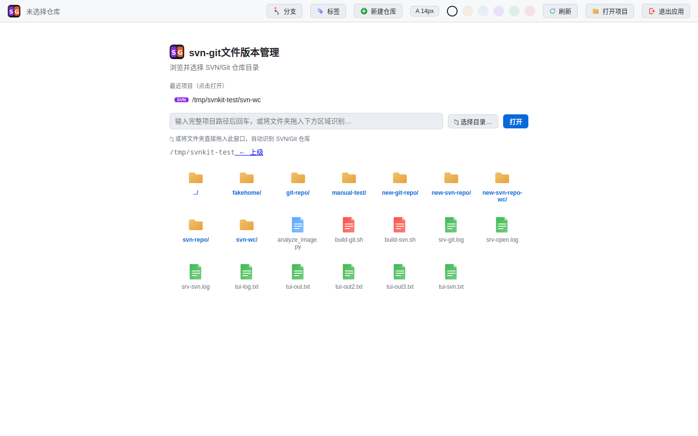
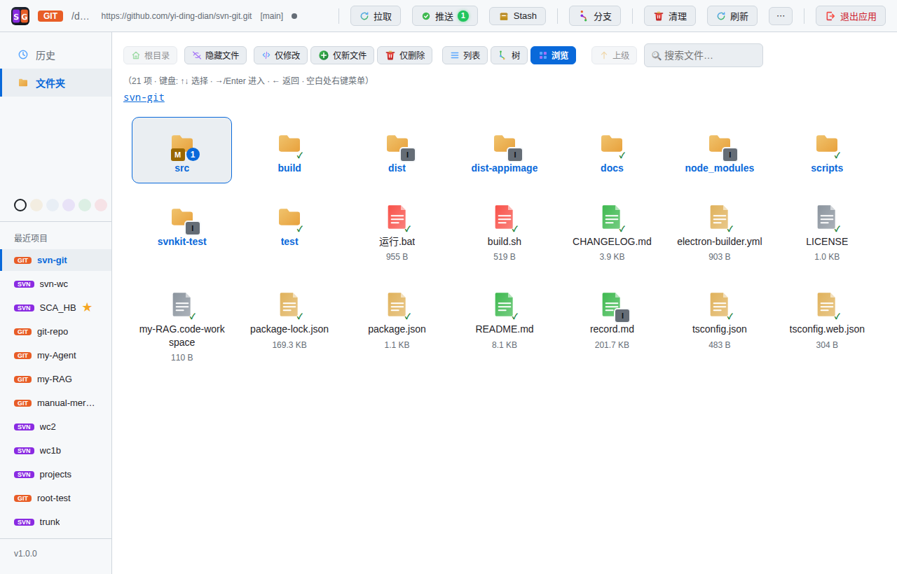
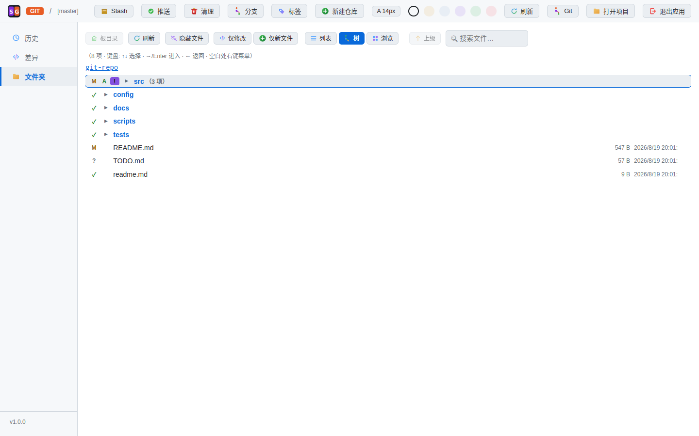
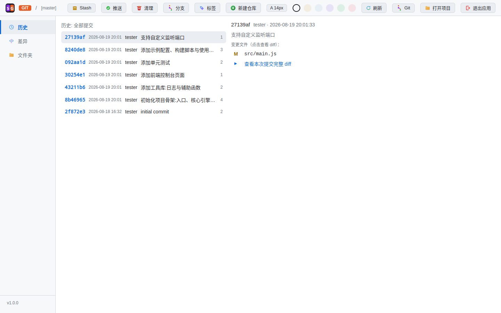
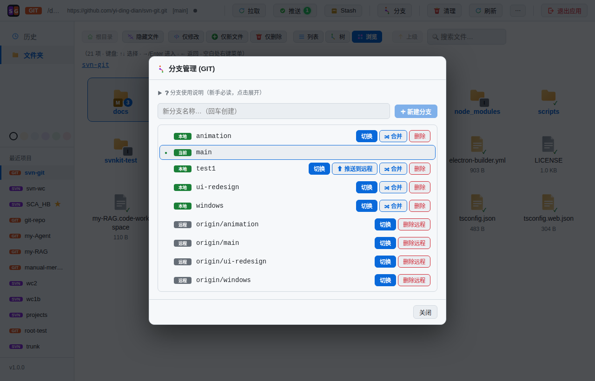
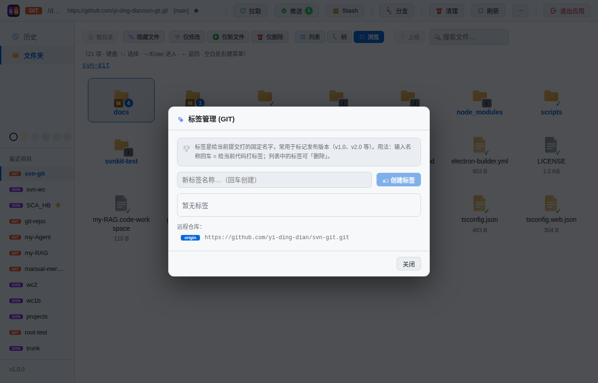
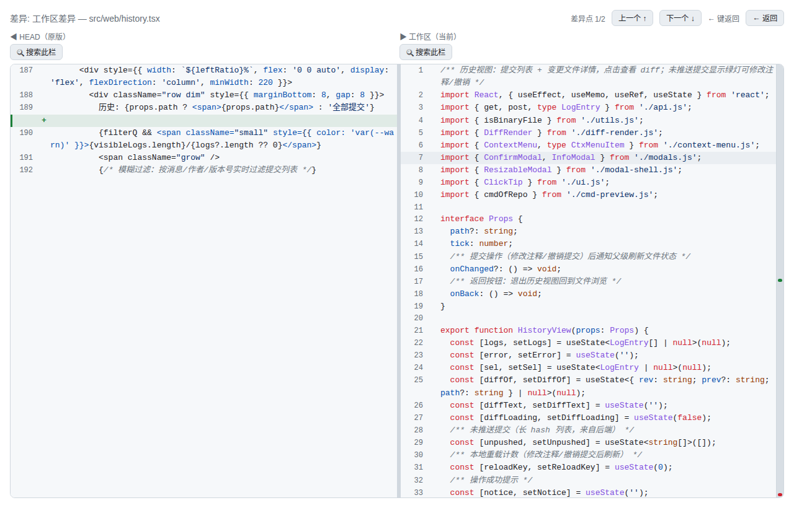
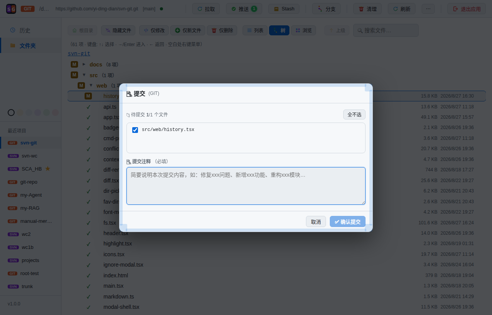

# svn-git 文件版本管理

> **SVN / Git 双引擎图形化版本管理工具**:浏览器界面、行级冲突防护,一套工具统一管理两种版本库。


在 Linux 桌面上同时使用 SVN 和 Git 的项目团队,不用再装两套 GUI 客户端。本工具提供状态检测、历史记录、并排差异对比、分支/标签/Stash、文件夹浏览,以及行业内少见的**行级冲突检测 + 提交拦截 + 三方冲突解决**完整防护闭环。纯本地服务,凭据不落盘明文,操作命令全程透明可预览。

- 详细使用教程: [Git 使用说明](docs/usage-git.md) · [SVN 使用说明](docs/usage-svn.md)
- 架构设计: [docs/architecture.md](docs/architecture.md) · 项目优势: [docs/advantages.md](docs/advantages.md)

---

## ✨ 特色一览

| 特色 | 说明 |
|---|---|
| **双引擎统一** | 自动识别仓库类型,SVN / Git 同一套界面与操作,分支/标签/提交/更新/还原体验一致 |
| **行级冲突防护闭环** | 提交前精确到"哪个文件第几行冲突"强制拦截 → 服务器更新交集提示 → 2 分钟主动监控 → 三方冲突解决器,四层防护一气呵成 |
| **命令预览** | 悬浮任何操作按钮/菜单项,直接显示"将执行的真实命令",教学与透明两不误 |
| **凭据安全** | SVN 密码走 `--password-from-stdin`(ps 不可见)、配置文件 600 权限;Git 推送认证 base64 存储 + `GIT_ASKPASS` 重试 |
| **零部署轻量** | 单个 AppImage(约 97MB)内置 Electron,目标机无需 Node/浏览器;后端零框架,只监听 127.0.0.1 |

---

## 🚀 快速开始

### 方式一:AppImage(推荐,免装 Node、免装浏览器)

下载 `svn-git-1.0.0.AppImage` 后:

```bash
chmod +x ./svn-git-1.0.0.AppImage   # 首次需要执行权限
./svn-git-1.0.0.AppImage            # 直接运行
SVNGIT_DIR=/path/to/repo ./svn-git-1.0.0.AppImage   # 指定启动目录(是仓库就直接打开;不指定用当前目录)
```

默认启动后弹出**应用窗口**(内置 Electron 渲染引擎,不依赖系统浏览器);关闭窗口即退出。

**终端里直接运行**(不带参数)会先让选择运行方式:应用窗口 / 浏览器 · 前台 / 浏览器 · 后台;带 `--browser` 或 `-d` 参数则跳过菜单、按参数直接生效(脚本和桌面快捷方式友好)。

**使用系统浏览器**:加 `--browser` 参数改用浏览器标签操作:

```bash
./svn-git-1.0.0.AppImage --browser
```

此时服务在后台运行,用页面右上角「退出应用」停止。需要**命令立即返回**、服务常驻后台就加 `-d`:

```bash
./svn-git-1.0.0.AppImage --browser -d
```

`-d` 会自动补齐 `--browser`;启动后命令立即返回(不占终端),浏览器照常自动打开,停止方式不变。

> 环境要求:
> - 系统需安装 `svn` 和 `git` 命令(工具启动时自动检测,缺失时引导安装)
> - AppImage 依赖 FUSE;无法挂载时用 `--appimage-extract-and-run` 运行

### 方式二:源码运行

一键脚本(装依赖 → 构建 → 启动,浏览器自动打开 http://127.0.0.1:23456):

```bash
./run.sh               # Linux / macOS
```

Windows 直接双击项目根的 `run.bat` —— 两边做的是同一件事。手动分步:

```bash
npm install
npm run dev            # 开发模式(热更新,用浏览器访问 http://127.0.0.1:23456)
npm run dist:linux     # 打包 AppImage
```

### Windows

Windows 产物在本地打包:双击 `deploy/build.bat` 出**免安装单文件 exe**(portable,对标 Linux 的 AppImage),`npm run dist:win` 出**安装包**,产物都在 `deploy/release/`——详见 `deploy/README.md`。安装包另由 GitHub Actions 在 tag 发布时自动构建(见 `.github/workflows/release.yml`)。Windows 前置:SVN 命令行两条路——装纯命令行的 [SlikSVN](https://sliksvn.com/)(`winget install --id=Slik.Subversion -e`,推荐:工具本身就是图形界面,不需要再来个 GUI),或装 [TortoiseSVN](https://tortoisesvn.net/) 时**必须勾选 `command line client tools`**(默认不勾选,勾选后才有 svn.exe 并加入 PATH);再装 [Git for Windows](https://git-scm.com/)。工具内「环境检测 → 下载安装」可一键装 SlikSVN。项目根目录的 `run.bat` 可在 Windows 下以源码方式一键安装依赖并启动。

和 AppImage 一样,exe 默认弹**应用窗口**;**用系统浏览器**操作就加 `--browser` 运行(portable 包装器会把参数原样转发给内层程序):

```bat
svn-git-1.0.0-portable.exe --browser
```

此时不弹应用窗口,自动打开默认浏览器访问 `http://127.0.0.1:23456`(端口被占用时自动换);服务只监听**本机** `127.0.0.1`,停止用页面右上角「退出应用」。Windows 没有 `&`,需要命令立即返回、服务常驻后台就加 `-d`:

```bat
svn-git-1.0.0-portable.exe --browser -d
```

指定启动目录同样用环境变量:`set SVNGIT_DIR=D:\repo` 后再运行(CMD)。

---

## 📸 功能预览

| 打开项目(目录浏览) | 文件浏览网格(状态徽标) |
|---|---|
|  |  |

| 树视图 | 历史记录 |
|---|---|
|  |  |

| 分支管理 | 标签管理 |
|---|---|
|  |  |

| 并排差异对比 | 勾选式提交 |
|---|---|
|  |  |

> 截图均来自 Git 仓库;SVN 仓库的界面与操作完全一致(工具栏少 Stash/推送,多更新/清理/登录),见 [SVN 使用说明](docs/usage-svn.md)。

---

## 🏗 技术栈与项目结构

### 技术栈

| 层 | 技术 |
|---|---|
| 前端 | React 18 + TypeScript(esbuild 单文件打包,约 850KB) |
| 服务 | Node 内置 http(REST API + SSE),仅监听 127.0.0.1 |
| 桌面外壳 | Electron(可选;纯 node 也能跑,供浏览器访问) |
| VCS | 包装官方 `svn` / `git` 命令行(`--xml` / `--porcelain` 机器格式) |

### 目录结构

```
src/
├── main/              # Electron 入口(打包版窗口 / --browser 外部浏览器)
├── preload/           # Electron preload
├── config.ts          # 配置读写(~/.config/svngit/config.json,600 权限)
├── server/
│   ├── index.ts       # HTTP 服务层(API + 静态文件 + 路由分发)
│   └── routes/        # API 路由域(13 个域模块 + util 共享工具:操作/分支/冲突/浏览/上传/终端/历史/…)
├── vcs/               # VCS 抽象层
│   ├── types.ts       #   统一 Vcs 接口(平台独有能力可选)
│   ├── index.ts       #   createVcs 工厂
│   ├── svn.ts         #   SVN 实现(包装 svn 命令行)
│   ├── git.ts         #   Git 实现(包装 git 命令行)
│   ├── ignore.ts      #   忽略规则(.gitignore / svn:ignore 的权威判定与写入)
│   ├── diff-lines.ts  #   行级冲突算法(纯函数)
│   ├── exec.ts        #   子进程封装(stdin 传密码/超时/取消/输出上限)
│   └── detect.ts      #   仓库类型识别
├── platform/          # 平台抽象(win32/linux 双实现:打开方式/图标/环境安装/终端运行)
├── shared/            # 前后端共享(类型常量 / 中英文案 / 文本编码探测)
└── client/            # React 前端(按业务域分目录)
    ├── shell/         #   主框架:视图调度/提交预检/冲突拦截/远程监控/侧边栏
    ├── filesystem/    #   文件夹浏览:列表/树/网格/多选/过滤树/右键菜单/剪贴板/拖拽上传
    ├── history/       #   历史记录与并排差异对比
    ├── conflicts/     #   三方冲突解决器 / 远程冲突
    ├── ops/           #   提交/推送/分支/标签/Stash 等操作弹窗
    ├── repo/          #   打开/创建仓库、登录认证、环境安装引导
    ├── appearance/    #   主题与字体(16 套内置主题 + 自定义「我的主题」)
    ├── terminal/      #   内置终端
    └── ui/            #   通用组件:弹窗外壳/图标/右键菜单/差异渲染/角标
scripts/               # 构建、开发、检查、截图脚本
deploy/                # 打包与发版(build.bat / build.sh 打包, release.bat / release.sh 发版 + 流程逻辑 release.mjs)
test/                  # 自动化测试(npm test 六个套件 + npm run test:e2e 前端冒烟)
```

### 架构

```
Web 前端(React + esbuild 单文件)
    ↕ REST API + SSE
HTTP 服务层(Node 内置 http,仅监听 127.0.0.1,固定端口 23456)
    ↕ 统一 Vcs 接口
VCS 抽象层(SvnVcs / GitVcs,包装官方命令行)
    ↕
svn / git 命令行(系统安装)
```

- 只解析官方 `--xml` / `--porcelain` 机器格式,不解析内部格式
- 密码走 `--password-from-stdin`(ps 不可见),配置文件 600 权限

---

## 📦 功能总览

### 状态与浏览

- **三种文件视图**:列表 / 树 / 文件浏览器(图标网格、状态角标、修改数量标识),切换保留位置与选中
- 文件/文件夹状态徽标:M 黄 / A 绿 / D 红 / ? 灰 / ! 紫 / C 红底
- **状态过滤**:工具栏「仅修改 / 仅新文件 / 仅删除」可多选组合,过滤结果以树视图展示,**双击文件直接跳转定位**(带面包屑点亮动画)
- **行数过滤**:搜索框模式菜单选「行数」,输入 `1000`(≥1000 行)、`>1000` 或 `<100`,点「确定」后按行数筛选当前目录(含子目录);结果以树形展示行数 / 大小 / 修改时间,双击文件跳转定位,用于排查大代码文件
- 文件名搜索(自动定位)、键盘导航(↑↓ 选择、→/Enter 进入、← 返回)、右键上下文菜单、面包屑导航
- **多选批量操作**:浏览模式矩形框选 / Ctrl 点选,列表与树 Ctrl+Shift 范围选;右键菜单按选中集合的**操作能力分组**(添加 / 提交 / 还原 / 从版本库移除 / 移到回收站 / 复制路径,各自带计数,混选自动拆分不误伤);还原按状态动态命名(全 A =「取消添加」、全 D =「恢复删除」)
- **文件/文件夹重命名**:右键「重命名」,版本化文件走 `svn move` / `git mv`(提交后生效),未版本化(?/I)文件直接磁盘改名
- **文件剪贴板**:复制 / 剪切(版本化条目走 `svn move` / `git mv`)→ 到任意目录「粘贴到这里」;剪贴板非空时右键菜单第一项即是粘贴项,紧邻一行「取消复制 / 取消剪切」随时清空(剪切中的条目在列表里半透明标记)
- **拖拽上传**:把文件/文件夹拖进窗口即上传到当前目录,同名冲突可选覆盖 / 跳过 / 逐个改名;复制进来的版本化副本自动加入版本库
- **Markdown 预览**:md 文件渲染预览 + 文档目录浮层(点条目跳转),图片与代码高亮,8 档阅读主题(跟随界面 + 白纸 / 羊皮纸 / 护眼绿 / 报纸 / 夜间 / 暗夜蓝 / 高对比)
- **内容复制**:文件预览 / 差异正文右键可「复制所选内容 / 复制全部内容」,`Ctrl+A` 全选正文(不含行号与界面文字),复制成功提示「已复制」
- **模块索引**:解析仓库内 md 的「目录树 ← 说明」或「| 路径 | 说明 |」表格,勾选后把说明注入到对应目录的文件列表(作用范围限该目录及子树),浏览代码时每个文件带一句话描述
- 常用文件夹预加载(SVN:右键加入后后台递归缓存,点击秒开)

### 历史与差异

- 提交历史:版本/作者/时间/信息,**顶部显示提交总数**(如「历史: 全部提交(92)」),支持按消息/作者/版本号模糊过滤
- Git 历史中未推送提交带绿点标记;未推送提交可右键**修改注释**(amend/reword)或撤销(reset --soft)
- **并排双栏对比**:左原版右当前,修改行 M 标记,滚动条绿红点全局预览,点击修改处双向跳转;**中间分隔栏可拖动**调整左右宽度(15%–85%)
- 左右栏**独立搜索框**,分别定位各自栏内代码
- 代码语法高亮(C/C++/Python/JS/TS 等 11 种)、文件内代码搜索
- Blame 逐行追溯(版本 + 作者)

### 版本管理操作

- **SVN + Git 统一**:分支(创建/切换/合并/删除)、标签(创建/删除);切换/合并前自动预检工作区改动与冲突文件
- **Git 专属**:Stash(保存/恢复/丢弃)、推送(未推送计数角标 + 确认弹窗 + 进度窗可取消)、清理未跟踪文件、修改提交注释、撤销提交
- **Git 远程分支**:分支弹窗中远程行可直接「删除远程」(git push --delete,进度窗可取消);本地未推送分支可「推送到远程」(首次自动建立上游跟踪)
- **SVN 专属**:锁定/解锁、svn:ignore 忽略、svn cleanup、切回主干、更新结果详情弹窗(终端式状态字母列表 + 按状态统计 + 当前版本号 + 警告完整展示)
- 创建/克隆仓库(git init / git clone / svnadmin create);**获取即后台任务**——点确认弹窗立刻关闭,进度/取消在顶栏沙漏,完成自动打开项目、失败进铃铛,认证失败自动弹凭据框并重试;退出时收掉在跑的 git/svn 子进程,异常退出留下的孤儿进程与半截目录在下次启动清理
- **勾选式提交**:提交弹窗内文件可勾选(默认全选,一键全选/全不选),提交前二次确认;未版本化(?)文件不进入提交列表(需先"添加到版本库")
- **命令预览**:悬浮菜单项/按钮显示将执行的真实命令(git/svn 双引擎模板,50+ 处接入)

### 🛡 并发修改防护(特色)

1. **行级冲突检测**:提交时精确提示"哪个文件第几行冲突",强制拦截 + 处理指引(备份 → 删除 → 更新 → 手动合并)
2. **服务器更新交集提示**:服务器有新提交且**待提交文件与服务器更新文件有交集**时,弹窗列出可能冲突文件(双击查看差异、可先更新);无交集不打扰
3. **2 分钟主动监控**:你修改的文件被他人先提交 → 警示条 + 「查看对比」(对方改动 diff vs 你的改动 diff)
4. **三方冲突解决器**:基础/本地/对方三栏对比,采用本地/对方/手动编辑,一键解决;合并前另有 **merge-tree 三方预检**,提前预告"即使提交后再合并仍会冲突"的文件

### 界面与体验

- **16 套内置主题**(浅色 / 深色,侧边栏「⋯」一键切换,即时预览)+「我的主题」自定义 6 色;字号与字体设置,`Ctrl+滚轮` 快速缩放文字(鼠标在文件内容区时只缩放内容、界面不动;鼠标旁显示百分比,`Ctrl+0` 复原 100%);彩色 SVG 图标(不依赖系统 emoji 字体)
- **弹窗通用可调整大小**:边缘/四角 8 方向拖拽,右上角最大化/还原/关闭
- 中文本地化、中文文件名/提交信息完整支持
- SVN 登录管理(账号切换/退出登录)、Git 认证引导(GitHub token / 服务器密码 / SSH 三种场景分引导)、环境检测与安装引导(SSE 实时日志)
- **终端**:右键脚本「终端运行」(.bat / .cmd / .sh 在系统终端窗口里跑,跑完窗口保留);`Ctrl+\`` 打开内置终端(命令历史随服务会话保留,重启清空)
- 远程网络状态灯:30 秒检测,最近 3 次结果三态(绿/黄/红),认证失败单独区分,点击圆点手动检测
- **顶栏 GitHub 身份徽标**:进入 GitHub 项目自动识别(自己的仓库 / 协作者 / 只读 / 无法访问),悬浮显示权限与登录名、点击打开「GitHub 仓库信息」;服务端缓存 30 分钟,未配置 Token 不发请求,断网或限流时静默不显示
- **我的 GitHub 仓库**:顶栏 GitHub 图标打开名下仓库列表(含私有,按最近推送排序),标出「当前项目」与本地已有副本;双击克隆到本地(复用获取仓库弹窗,克隆完自动打开),右键可开浏览器/复制地址

---

## 🧪 测试

```bash
npm test         # 一键执行全部断言(vcs / vcs-extra / diff-lines / diff-parse / api / upload 六个套件)
npm run test:e2e # 前端冒烟(Playwright 驱动真实浏览器,需先 npm run build)
```

| 测试文件 | 覆盖 |
|---|---|
| `test/vcs-test.mjs` | VCS 层 50+ 项(git/svn 状态、提交、还原、重命名等,自动重建测试仓库) |
| `test/vcs-extra-test.mjs` | 扩展功能 50 项(分支/标签/Stash/忽略/冲突等) |
| `test/diff-lines-test.mjs` | 行级冲突算法 6 项 |
| `test/diff-parse-test.mjs` | 差异解析 15 项 |
| `test/api-test.mjs` | HTTP API 集成 60+ 项(真实服务端到端:越界拦截/CSRF/缓存失效/软删 keep/重命名/忽略闭环等) |
| `test/upload-test.mjs` | 上传/复制粘贴 28 项 |

> 测试仓库在项目根 `svngit-test/` 下(vcs-test 会自动重建 SVN 仓库并将 Git 仓库重置到固定基准提交,不依赖外部网络);CI(`.github/workflows/test.yml`)在 push/PR 时自动跑全量测试。`vcs-*` 两套需要本机已安装 `svn` / `svnadmin`(缺失时会在重建 SVN 测试仓库处直接失败)。

---

## 🤝 贡献与许可

欢迎通过以下方式参与:

- **提 issue**:报告 bug、功能建议、使用疑问
- **提 PR**:修复问题、改进界面与交互
- **翻译**:完善界面文案与其他语言的文档

请先阅读 [docs/architecture.md](docs/architecture.md) 了解架构,PR 请附带对应测试。

本项目使用 [MIT License](LICENSE) 开源。

Copyright © 2026
