# Git 使用说明

> 本文介绍如何用 **svn-git 文件版本管理** 工具日常管理 Git 仓库：打开项目、查看状态、提交、分支、推送、解决冲突。
> 使用 SVN 仓库请阅读 [SVN 使用说明](usage-svn.md)，两篇结构一致，可以对照阅读。

## 目录

1. [打开项目](#打开项目)
2. [界面布局与三种视图](#界面布局与三种视图)
3. [状态徽标含义](#状态徽标含义)
4. [查看历史与差异](#查看历史与差异)
5. [修改与提交](#修改与提交)
6. [部分提交（按块暂存）](#部分提交按块暂存)
7. [分支 / 标签 / Stash / 推送](#分支--标签--stash--推送)
8. [检出与工作树](#检出与工作树)
9. [代码统计](#代码统计)
10. [发布与在线更新](#发布与在线更新)
11. [局域网共享](#局域网共享)
12. [GitHub 集成](#github-集成)
13. [练习仓库](#练习仓库)
14. [冲突处理](#冲突处理)
15. [多选批量操作](#多选批量操作)
16. [重命名 / 移动](#重命名--移动)
17. [主题 / 快捷键 / 终端](#主题--快捷键--终端)
18. [常见问题](#常见问题)

---

## 打开项目

启动工具后，默认进入「打开项目」界面（已打开仓库时，点顶部工具栏「⋯」→「打开项目」可随时打开）。这里有三种方式定位你的仓库：

1. **输入路径**：在上方输入框输入仓库完整路径后回车，自动识别并进入
2. **目录浏览**：从下面的文件网格逐级点进目录，找到仓库后点击「进入此仓库 →」
3. **拖拽**：直接把仓库文件夹拖进窗口，自动识别

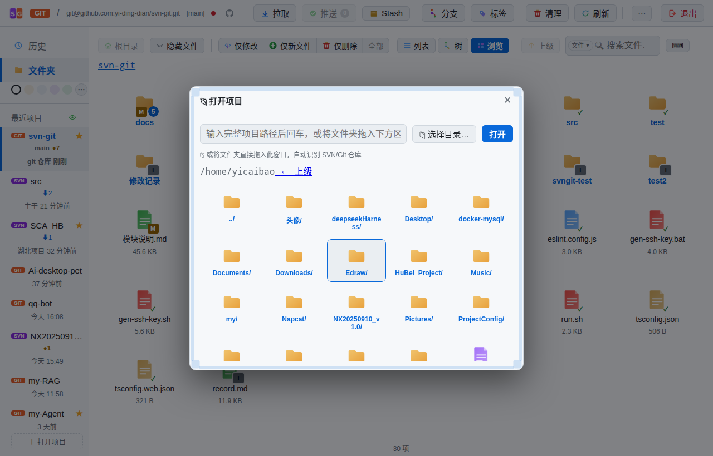

进入仓库后，顶部会显示仓库类型徽标（GIT）、当前分支（如 `main`）和远程地址；左侧「最近项目」会记录打开过的仓库，下次点击即可直达（右键可删除、设常用、写备注）。带 ★ 的常用项目在启动时优先打开；最近项目还会显示 ⬆ / ⬇ / ● 等远程状态徽标，鼠标悬浮可一键拉取。

> 启动时指定目录，用环境变量 `SVNGIT_DIR`：`SVNGIT_DIR=/path/to/repo ./svn-git-1.7.2.AppImage`（不指定则用当前工作目录）

---

## 界面布局与三种视图

打开仓库后，界面分为三块：

- **左侧边栏**：视图导航（历史 / 文件夹）+ 最近项目列表 + 主题快捷圆点
- **顶部工具栏**：仓库信息、拉取、推送、Stash、分支、标签、清理、刷新、「⋯」更多（打开项目 / 新建仓库 / 获取仓库 / 终端 / 项目代码统计 / 字体设置 / Git 信息与配置 / GitHub 仓库信息 / 发布 / 共享配置 / 环境检测 / 语言 / 关于）、退出应用
- **中间主区**：文件视图，默认是「浏览」（文件管理器网格）

主区左上角提供 **列表 / 树 / 浏览** 三种视图切换，各自适合不同场景：

| 视图 | 特点 | 适合场景 |
|---|---|---|
| 浏览（默认） | 图标网格，文件 / 文件夹状态角标 + 目录变更数量 | 日常查看状态 |
| 树 | 完整目录树，展开 / 收起，可看到深层文件的徽标 | 快速定位文件 |
| 列表 | 表格行，带操作按钮，信息密度高 | 批量处理文件 |

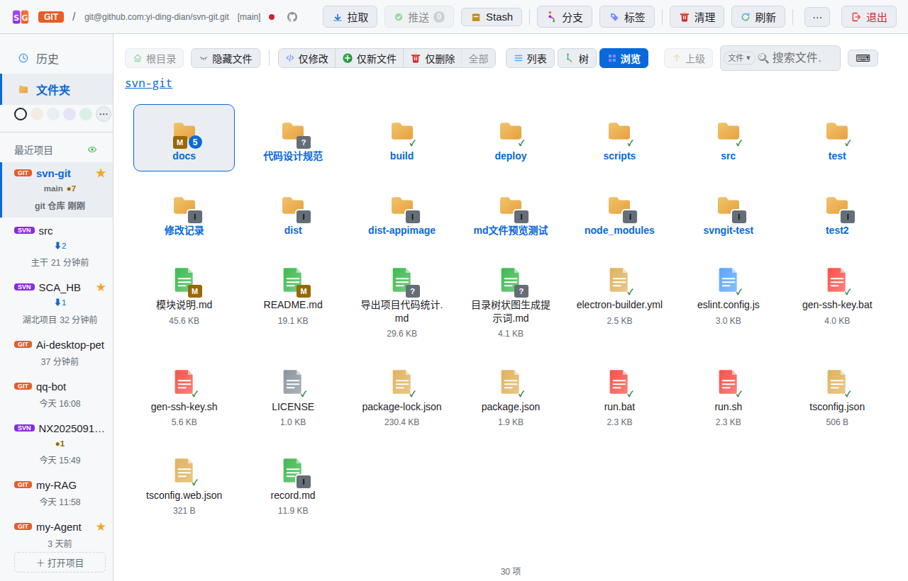

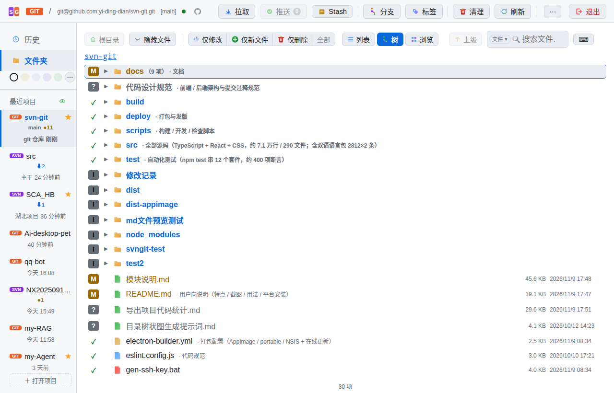

三种视图都支持：

- **过滤**：「仅修改」「仅新文件」「仅删除」可多选组合；过滤后主区切换为**过滤树**（目录自动聚合），**双击文件直接跳转**到该文件所在目录并选中（带面包屑点亮动画）
- **搜索文件**：输入文件名自动定位（树视图自动展开父目录）；搜索框模式菜单还可切换「内容搜索」「行数」过滤
- **行数过滤**：输入 `1000`（≥1000 行）、`>1000` 或 `<100`，按行数筛选当前目录（含子目录），适合排查大代码文件
- **键盘导航**：`↑` `↓` 选择、`←` `Enter` 进入 / 返回、空白处右键打开操作菜单
- **右键菜单**：按文件状态动态生成可用操作（查看差异 / 提交 / 还原 / 重命名 / 从版本库移除 / 查看历史 / 忽略 / 打开方式等），**悬浮任意菜单项或按钮会显示将执行的真实命令**
- **多选**：网格矩形框选 / Ctrl 点选、列表与树 Ctrl+Shift 范围选；右键菜单按操作能力分组
- **拖拽**：文件 / 文件夹拖进窗口上传到当前目录；可删条目拖到窗口边缘丢弃到回收站
- **Markdown 预览**：双击 md 文件查看渲染结果，支持文档目录浮层与 8 档阅读主题
- **模块索引**：右键「模块索引…」解析仓库内 md 的目录树 / 表格，把一句话说明注入到对应目录的文件列表
- 顶部「刷新」按钮重新扫描状态；「⋯」→「Git 信息与配置」可查看 / 修改远程地址

---

## 状态徽标含义

文件（或文件夹）角标上的字母表示其版本状态，与 `git status` 一致：

| 徽标 | 含义 | 说明 |
|---|---|---|
| **M** 黄 | 已修改 | 内容与上次提交不同 |
| **A** 绿 | 已添加 | 已 `git add` 暂存的新文件 |
| **D** 红 | 已删除 | 已被删除，尚未提交 |
| **?** 灰 | 未跟踪 | 新建文件，从未加入版本库 |
| **!** 紫 | 缺失 | 文件不在了（如被其他程序删除） |
| **C** 红底 | 冲突 | 合并 / 更新时产生冲突，需处理 |
| **R** 绿 | 已重命名 | 被 `git mv` 改名，尚未提交 |
| **I** | 已忽略 | 被 `.gitignore` 规则匹配 |
| **U / ~** | 已更新 / 类型变更 | 较少见，提交时自动处理 |

文件夹的角标会聚合子目录的变更，并显示变更数量（如 `M 5` = 目录内有 5 个修改文件）。`?` 未跟踪的新文件不参与提交，需先右键「添加到版本库」。

---

## 查看历史与差异

### 历史记录

点击左侧边栏「历史」进入历史视图，展示仓库全部提交：

- 顶部显示**提交总数**，支持按消息 / 作者 / 版本号**模糊过滤**
- 每条提交显示：短哈希、时间、作者、提交说明、变更文件数；**未推送**的提交带绿点标记（悬浮显示「本地领先远程 N 个提交」）
- 点击任意提交，右侧显示变更文件列表，可跳转查看该提交的完整差异
- 从文件视图右键「查看历史」，可只看某个文件 / 目录的历史（顶部显示路径过滤）
- **未推送提交右键**：最近一条（HEAD）可「修改注释」「撤销提交（--soft）」；其余未推送提交可「重写注释」（rebase 重写，代码内容不变）

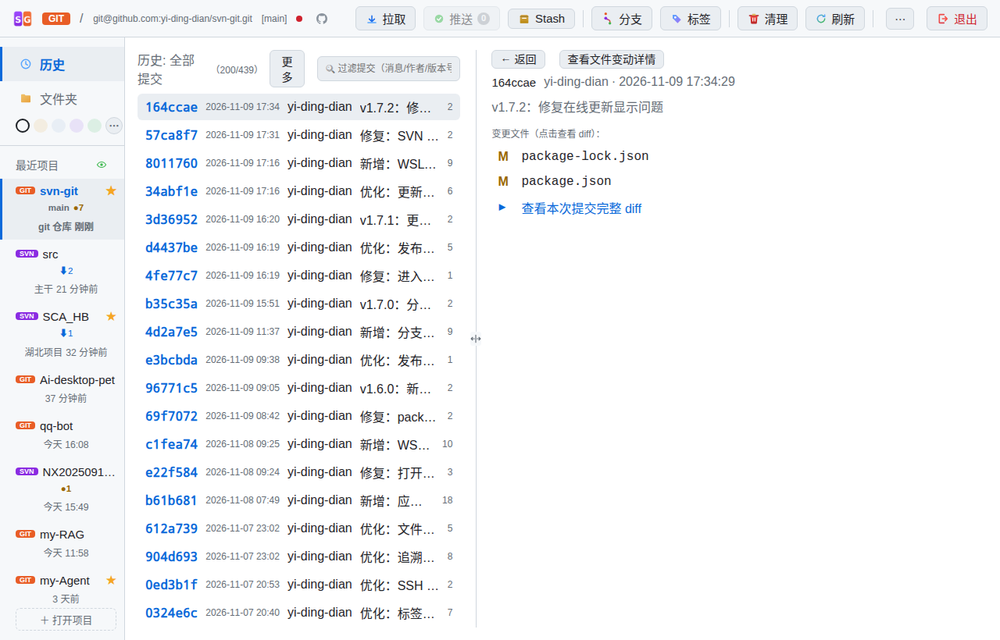

### 差异对比

在浏览视图中**双击任一修改（M）文件**，直接进入并排差异对比界面：

- **左右双栏**：左栏「原版」、右栏「当前」，修改行以 M 标记并高亮
- **滚动条预览**：全局绿（新增）红（删除）点，一眼看到改动分布
- **点击跳转**：点击任一栏的修改处，另一栏自动滚动到对应位置
- **拖动分隔栏**：中间分隔栏可左右拖动（15%–85%），按需调整两侧宽度
- **独立搜索**：左右栏各有搜索框，可分别定位各自栏内代码
- **语法高亮**：C/C++、Python、JS/TS 等 11 种语言自动高亮
- **按块还原 / 就地编辑**：差异中可逐块还原，也可在右栏直接编辑
- **逐行追溯（Blame）**：在文件预览中开启，标注每行最后修改的版本与作者

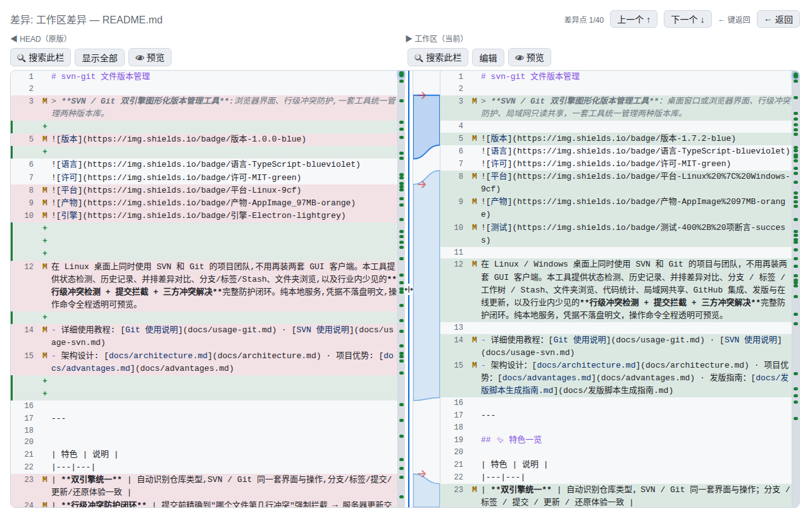

> 想对比提交与提交之间的差异：在历史视图中选中提交，从右侧变更文件进入。

---

## 修改与提交

1. 在编辑器或终端里修改文件，回到工具点「刷新」（或自动感知——状态每 30 秒缓存刷新，写操作后立即失效）
2. 文件角标变为 **M**，文件夹徽标同步更新
3. 在浏览视图**空白处右键 →「提交修改的文件…」**，打开勾选式提交弹窗：

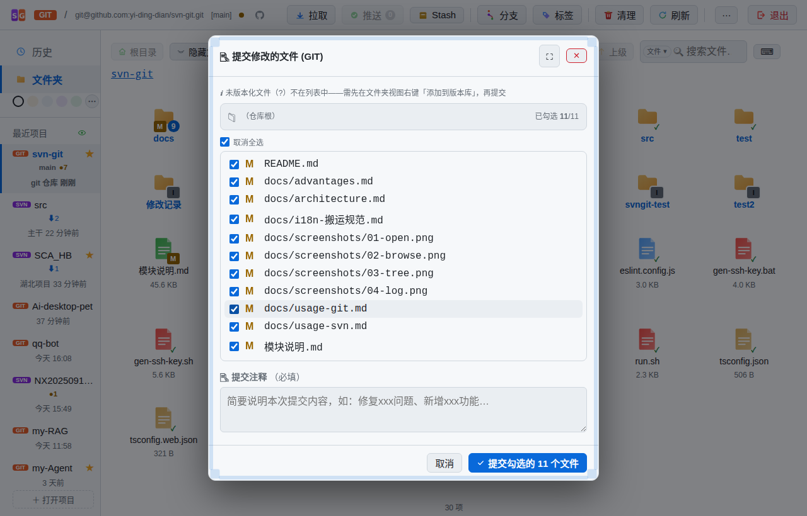

提交弹窗要点：

- **勾选文件**：默认全选，可取消勾选不想提交的文件；支持一键「全选 / 全不选」
- **提交注释（必填）**：填写本次提交说明，如「修复登录超时问题」；`Ctrl+Enter` 快速提交
- **二次确认**：点击「✅ 提交勾选的 N 个文件」后，还会再确认一次，避免误提交
- `?` 未跟踪文件不会出现在提交列表，需先右键「添加到版本库」
- 弹窗标题栏悬浮会显示将执行的 `git commit` 命令

提交成功后，顶部提示条会显示提交分支和短哈希（如 `提交成功 main 8f3a2b1`）。

> 提交前工具会自动做安全检查：如果存在行级冲突，会强制拦截并引导处理，详见[冲突处理](#冲突处理)。

---

## 部分提交（按块暂存）

一个文件里只有部分改动想先提交？在提交弹窗中点击文件旁的「按块提交」：

- 弹窗列出该文件的 diff 分块（hunk），逐块勾选要暂存的改动
- 确认后执行 `git apply --cached`，只把选中的块加入暂存区
- 剩余改动保留在工作区，可继续编辑或下次提交
- 弹窗底部可展开查看将执行的完整命令

---

## 分支 / 标签 / Stash / 推送

### 分支管理

点顶部工具栏「分支」打开分支管理弹窗（顶部有「分支使用说明」折叠块，新手可展开）：

- **创建**：输入新分支名回车（或点「➕ 新建分支」），基于当前分支创建
- **切换**：绿色「当前」标记所在分支；其他分支点「切换」即切换过去——切换前自动检查工作区改动，无修改直接切，有修改精确提示
- **合并**：把某分支的改动并入当前分支。合并前自动预检：工作区文件级重叠会拦截；两边已提交改动重叠会预告「即使提交后再合并仍会冲突」（merge-tree 三方试算）
- **删除**：删除已合并的本地分支（主干 main/master 保护不可删）
- **推送到远程**：本地分支尚未推送时显示「⬆ 推送到远程」，首次推送自动带 `-u` 建立上游跟踪
- **删除远程**：远程分支（显示「远程」徽标）行有红色「删除远程」按钮（`git push origin --delete`），网络操作带进度窗可取消
- **检出 / 工作树**：分支行提供「检出」入口，可独立克隆或用 worktree 检出到另一个目录（见下节）

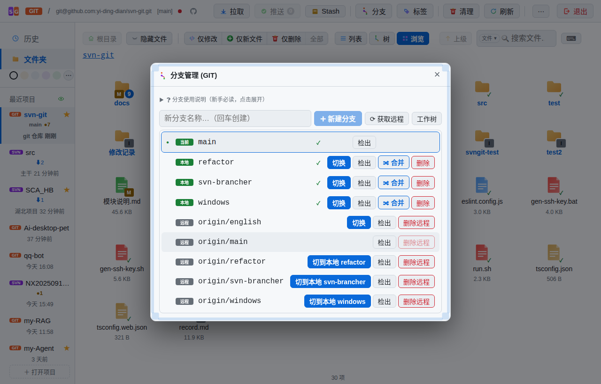

### 标签

点「标签」打开标签管理弹窗，输入名称回车即可在当前提交打标签（附注标签）；也支持删除标签、查看标签详情与检出。发布版本时的标记常用它。

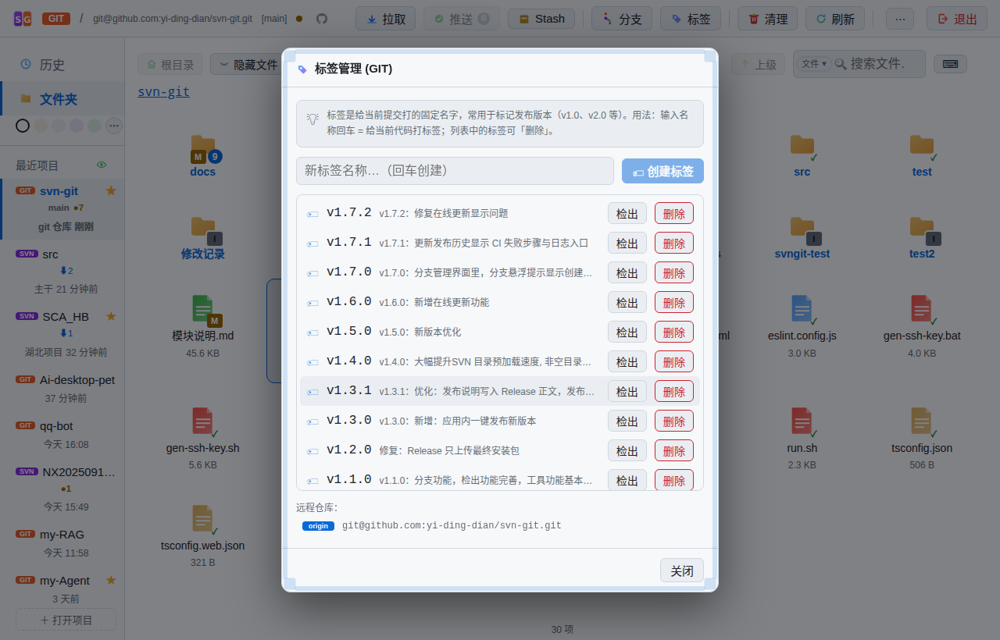

### Stash 暂存

工具栏「Stash」可以把当前工作区修改**临时保存并还原干净**，之后随时恢复——适合「先处理线上问题，再回来继续手头改动」：

- **保存**：命名暂存（自动包含未跟踪文件），工作区恢复干净
- **恢复**：把暂存内容取回工作区
- **丢弃**：放弃某条暂存记录

### 推送

工具栏「推送」按钮带**未推送提交计数角标**（如 `推送 3`），点击后弹出**推送确认窗**：列出全部未推送提交（含变更文件，可右键改注释 / 撤销），并检查与远程的差距：

- 当前分支**落后于远程**：提示「推送前需要拉取」，建议先更新合并，避免被远程拒绝
- 推送过程有进度窗，**网络卡住可取消**；认证失败时按保存的凭据（`GIT_ASKPASS`）自动重试一次，仍失败则弹出**认证引导**（按远程类型分 GitHub token / 服务器密码 / SSH 三种场景）

### Git 信息与配置

「⋯」→「Git 信息与配置」：查看当前分支、远程、上游、最近提交；可修改 origin 远程地址、管理多个远程、设置提交身份。

---

## 检出与工作树

分支 / 标签不只可以在当前目录切换，还能**检出到独立目录**，互不干扰：

- **分支检出**：分支行点「检出」，选择「独立克隆」或「工作树（worktree）」
  - 独立克隆：完整复制一份仓库（可浅克隆，节省空间）
  - 工作树：`git worktree add`，共享同一份对象库，切换成本低
- **标签检出**：标签行点「检出」，可选择完整克隆或浅克隆到指定目录
- **工作树管理**：「⋯」→「Git 信息与配置」旁的工作树入口，或分支弹窗「工作树」按钮，可查看 / 打开 / 移除工作树，清理失效记录

检出任务在后台执行，顶栏沙漏显示进度，可取消；完成后自动打开新项目。

---

## 代码统计

「⋯」→「项目代码统计」（可拖到工具栏）：

- **目录勾选树**：默认全选一级目录，可展开细选；「整个项目」需显式勾选（含根目录文件）
- **文件范围**：仅代码文件 / 全部文本文件
- **流式统计**：显示进度、可取消；结果树中目录显示子树合计，文件显示自身行数
- 显示总行数、文件数、耗时、跳过项（空文件 / 二进制 / 超大文件 / 出错）
- **导出 Markdown**：一键生成目录树 + 每目录小计 + 每文件行数 + 总计的报告，可自定义文件名并另存

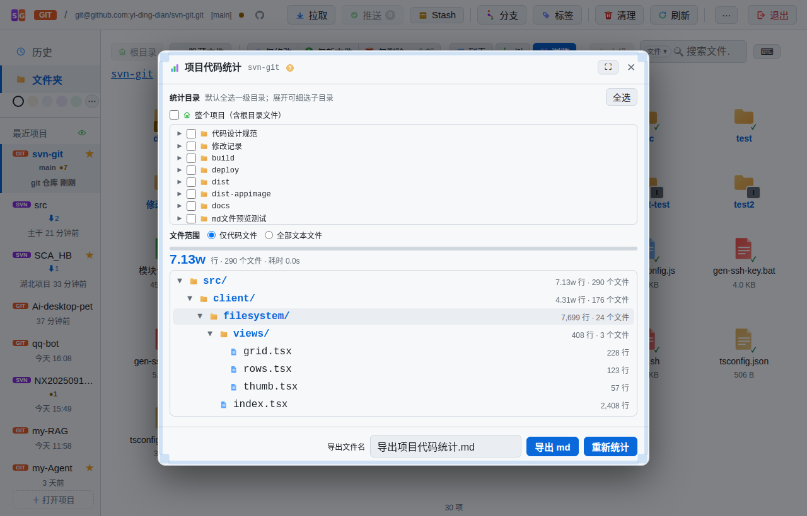

---

## 发布与在线更新

### 发布中心

「⋯」→「发布」（项目有远程仓库或发版脚本时出现）：

- **发布历史**：GitHub Releases 列表、各平台产物（AppImage / exe / tar.gz）大小与下载、源码包、GitHub 入口
- **发布新版本**：填写版本号 / 说明，调用项目自己的 `deploy/release.mjs` 执行发版
- **本地打包**：AppImage / Windows / WSL 一键构建
- **旧版本清理**：保留最近 N 个版本，批量删除更早产物
- **CI 状态**：发布历史显示 GitHub Actions 构建状态，失败时给出步骤与日志入口
- **Docker 镜像**：生成 Docker 发布脚本，并查询镜像大小

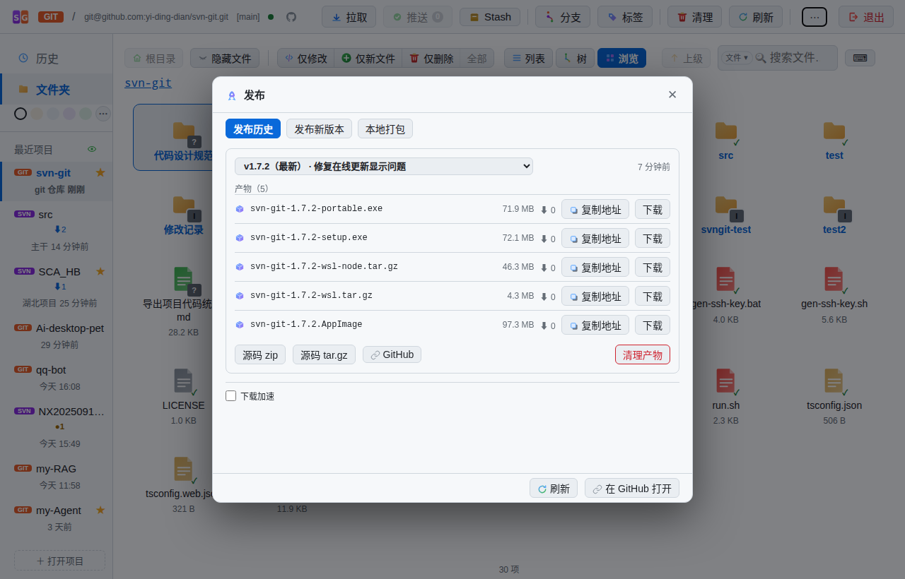

### 在线更新

AppImage / Portable / WSL 包启动后会静默检查新版本：

- 发现新版本后在「关于」或更新界面提示，可查看更新说明
- 下载过程显示进度，完成后「立即重启」安装
- WSL / 纯 Node 包校验 SHA256 后解压换版，失败自动回滚
- 源码运行（`npm run dev`）与 `--browser` 模式下不启用

---

## 局域网共享

「⋯」→「共享配置」（仅本机可见）：

- **访问范围**：仅本机 / 局域网（自动放行私网段）/ 自定义 IP · CIDR 白名单
- **远程权限**：默认**只读**（可查看历史、差异、文件，不能提交 / 编辑 / 推送）；可显式放开为可读写
- **人数上限**：按 IP 计，同一设备刷新 / 多标签不重复占位
- 弹窗显示可用的局域网访问地址，保存后服务重启并自动刷新
- 顶栏显示共享 / 只读徽标与在线人数；主机收到加入 / 离开通知

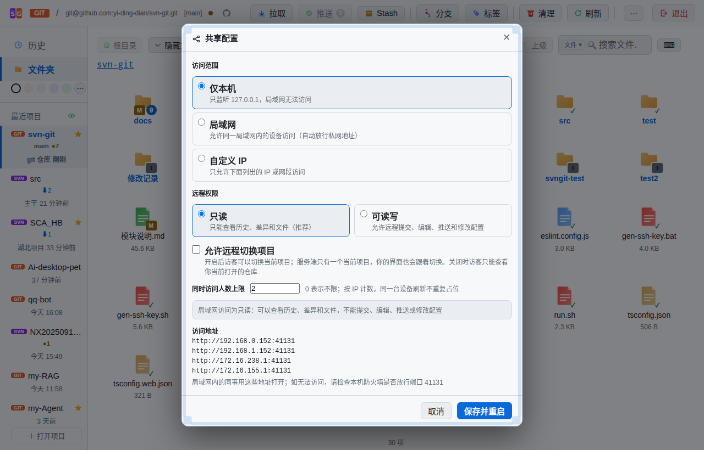

> 远程访客打开页面会经过门禁：未加入时等待、满员自动重试、被拒时提示原因。

---

## GitHub 集成

origin 指向 GitHub 的项目会自动启用：

- **身份徽标**：顶栏识别你是自己的仓库 / 协作者 / 只读 / 无法访问，悬浮显示权限与登录名
- **我的 GitHub 仓库**：顶栏 GitHub 图标打开名下仓库（含私有，按最近推送排序），双击克隆到本地
- **仓库信息**：描述、Star、语言构成；可打开 GitHub 页面
- **新建 / 删除远程仓库**、**Fork 到自己账号**
- **SSH**：项目根提供 `gen-ssh-key.sh` / `gen-ssh-key.bat` 生成密钥；认证失败按远程类型引导
- 需要 GitHub Token 的操作在设置中填写，未配置时相关入口自动隐藏或提示

---

## 练习仓库

「⋯」→「打开项目」旁的练习入口（或新建仓库弹窗）：

- 一键生成 **Git / SVN 练习仓库**，自带初始提交、分支、远程、领先 / 落后 / 分叉、冲突等场景
- 适合学习分支合并、冲突解决，或验证工具功能，不污染真实项目
- 生成失败会自动清理半成品目录

---

## 冲突处理

多人协作时，工具提供四层防护，把「冲突」从发现到解决串成闭环：

### 1. 行级冲突检测（提交拦截）

提交时精确比对文件行。如果某个文件的修改行与服务器版本重叠，直接**禁止提交**，并列出「哪个文件第几行冲突」，引导处理：

> 处理指引：备份 → 删除 → 更新 → 手动合并

### 2. 服务器更新交集提示

你准备提交时，服务器恰好有新提交。如果**待提交文件与服务器更新的文件有交集**，弹窗列出可能冲突的文件（**双击可查看差异**），可先更新再提交；没有交集则不打扰，直接进入提交。

### 3. 两分钟主动监控

你修改的文件被他人先提交了 → 顶部出现**警示条**：「你修改的 N 个文件已被他人先提交新版本」，可点击「查看对比」直接看「对方改动 vs 你的改动」两段差异，提前发现潜在冲突。

### 4. 三方冲突解决器

一旦产生真实冲突（文件状态 C，顶部出现「解决冲突」入口），打开三方解决器：

- **基础 / 本地 / 对方** 三栏：基础 = 双方共同的祖先版本，本地 = 你的修改，对方 = 别人的修改
- 底部「本地 vs 对方」双栏对比，M 标出具体冲突行
- **一键采用**：用你的版本 / 用对方的版本覆盖冲突文件
- **手动编辑**：直接在编辑区改好后再保存解决
- 合并失败时可在解决器中「中止合并」放弃本次合并

> 说明：打开解决器后，界面从上到下是「冲突文件列表 → 基础 / 本地 / 对方三栏 → 本地 vs 对方双栏对比 → 采用按钮」。

---

## 多选批量操作

工具支持对**多个文件一次性操作**，不必逐个处理：

- **浏览（网格）**：拖拽出矩形框选一片文件；或按住 Ctrl 点选
- **列表 / 树**：按住 Ctrl+Shift 范围选择连续行
- 选中后**右键**，菜单按选中集合的**操作能力分组**（各自带计数）：
  - 「添加到版本库（N 项）」——只作用于 ? 未跟踪文件
  - 「提交修改（N 项）…」「还原（N 项）」——只作用于 M/A/D/R/C 文件；还原按状态**动态命名**：全部 A 显示「取消添加（N 项）」、全部 D 显示「恢复删除（N 项）」
  - 「从版本库移除（N 项）」——本地保留，仅移出版本控制
  - 「移到回收站（N 项）」——未版本化 / 忽略文件移入系统回收站（可从回收站恢复）
  - 「复制完整路径（N 项）」
- 混选时工具自动拆分到对应分组，不会误伤

---

## 重命名 / 移动

右键文件或文件夹 →「重命名」，弹窗只需输入**新名字**（自动保留原目录）：

- **版本化文件**：执行 `git mv`，磁盘立即改名并标记为「已重命名」（提交后生效）；弹窗确认按钮会显示将执行的完整命令
- **未版本化（?）/ 被忽略（I）文件**：直接**磁盘改名**，不影响版本库

> 已删除（D）或调度中的文件不可重命名；重命名命令需在新名字弹窗中确认后才会执行。

---

## 主题 / 快捷键 / 终端

### 主题与外观

- 左侧边栏彩色圆点是 5 套常用主题快捷切换；点「⋯」打开完整主题气泡：**16 套内置主题**（11 浅色 + 5 深色）+「我的主题」自定义 6 色
- 「⋯」→「字体设置」：基础字号 12–20px、界面字体、代码字体
- `Ctrl+滚轮`：鼠标在文件内容区时只缩放内容，在界面区缩放界面；`Ctrl+0` 复原 100%
- 所有操作（添加 / 删除 / 还原 / 提交 / 更新 / 错误）带对应动效，尊重系统「减少动效」偏好

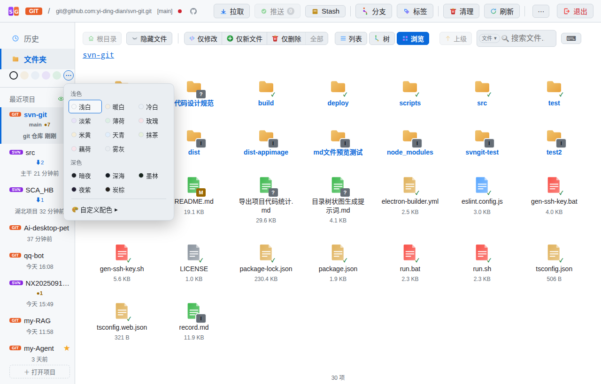

### 常用快捷键

| 快捷键 | 作用 |
|---|---|
| `Ctrl+`` ` | 打开 / 关闭内置终端（有弹窗时不响应） |
| `F5` | 刷新当前项目 |
| `Ctrl+滚轮` / `Ctrl+0` | 缩放 / 复原 |
| `Ctrl+A` | 内容区全选正文 |
| `Ctrl+C` / `Ctrl+X` / `Ctrl+V` | 文件复制 / 剪切 / 粘贴 |
| `↑` `↓` / `j` `k` | 选择文件 |
| `→` / `Enter` | 进入目录 / 打开文件 |
| `←` / `Backspace` | 返回上级 |
| `/` | 预览面板内搜索 |
| `Ctrl+Enter` | 提交注释框内快速提交 |

### 内置终端

`Ctrl+`` 打开终端：在仓库目录下执行 git 命令，保留命令历史、ANSI 上色；危险命令会二次确认。右键脚本文件还可「终端运行」（在系统终端窗口执行，跑完窗口保留）。

---

## 常见问题

**Q1：当前分支没有上游（upstream）信息，更新失败？**

Git 提示「no tracking information」时，工具会自动重试 `git pull origin <当前分支>`，无需手动设置上游。新分支第一次推送同理，推送会自动带 `-u` 建立跟踪。

**Q2：文件显示 !（缺失），怎么恢复？**

文件被其他程序删除时，右键该文件 →「更新」，或空白处右键「更新当前目录」，缺失文件会从仓库恢复。

**Q3：新建的文件是 ? 状态，提交弹窗里为什么没有？**

`?` = 未跟踪，git 不知道它该不该入库。先在文件上右键 →「添加到版本库」（等同于 `git add`），文件变 A 后才会出现在提交列表。如果它只是临时文件，可以右键 →「加入忽略…」写进 `.gitignore`。

**Q4：提交被拦截了，提示行冲突？**

按提示的指引处理：先备份你的文件 → 删除 → 更新获取服务器版本 → 手动把两边改动合并回文件，再重新提交。详细流程见[冲突处理](#冲突处理)。

**Q5：更新时提示「推送前需要拉取」？**

当前分支落后于远程，直接推送会被拒绝。点「去更新」先 `git pull` 合并，再推送即可。

**Q6：多选后右键菜单没有想要的操作？**

多选菜单按状态分组；混合选中时，工具会自动拆分到对应分组，不会误伤。

**Q7：怎么删除远程分支？**

打开「分支」弹窗，远程分支（带「远程」徽标）行上点红色「删除远程」按钮，确认后执行 `git push origin --delete <分支名>`。

**Q8：推送总是认证失败？**

推送认证失败时，工具会自动弹出**认证引导弹窗**：GitHub 用「用户名 + Personal Access Token」、自建 Git 服务器用「用户名 + 密码」、SSH 场景提示先配置密钥。保存后会自动用 `GIT_ASKPASS` 凭据重试。

**Q9：共享给同事后对方打不开？**

确认共享模式为「局域网」或「自定义 IP」并包含对方 IP；检查主机防火墙是否放行端口（默认 23456，被占用时随机）；对方需在同一网段。远程默认只读，若要允许写操作需在共享配置中显式开启。

**Q10：在线更新显示不支持？**

源码运行、`--browser / -d`、portable 之外的未打包形式不支持在线更新；AppImage、安装版和带 `.svngit-package.json` 的 WSL 包支持。

---

## 更多资源

- [SVN 使用说明](usage-svn.md)：SVN 仓库版的完整教程（锁定、svn:ignore、cleanup 等）
- [架构文档](architecture.md)：设计与实现细节
- [项目优势](advantages.md)：与同类工具对比
- [项目主页](../README.md)：快速开始与功能总览
